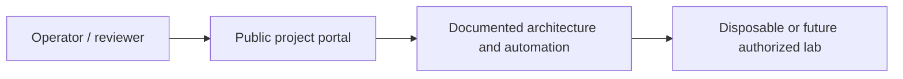

# DOMAINCORE | Windows Identity & Endpoint Management Platform

**Author:** Pratik Aeraple
**Public demonstration:** https://domaincore.brutehack.com
**Project status:** PowerShell automation: IMPLEMENTED · AD forest/GPO: DESIGNED · Entra ID/Intune: REQUIRES EXTERNAL PLATFORM

## Problem and objectives

A Windows identity and endpoint-administration lab: repeatable PowerShell workflows, an Active Directory design, and a clear boundary between code that exists and services that still need Windows or Microsoft cloud infrastructure.

This repository is a portfolio engineering project, not a claim that an enterprise environment or vendor tenant exists. The status labels apply to the specific artifacts described below.

## Architecture



Admin workstation → delegated operator group → OU-scoped Active Directory roles → domain DNS/DHCP → managed Windows endpoints. Entra ID and Intune extend identity and device policy after a separately governed tenant integration.

## What is implemented

- A production-built, non-root, read-only static demonstration portal with a project-specific health identity and exact hostname allowlist.
- PowerShell module for validated provisioning, group/OU management, safe disablement, inventory and account reporting.
- GPO baseline proposal and Entra ID / Intune reference architecture, explicitly labelled as design rather than deployed configuration.
- A clear implementation-status vocabulary and security-first setup instructions.

## Designed, simulated and external-platform work

No Windows Server, AD forest, Entra tenant or Intune enrollment is deployed here. PowerShell artifacts are designed for an authorized lab and default to preview/WhatIf for changes.

- **DESIGNED:** Admin workstation → delegated operator group → OU-scoped Active Directory roles → domain DNS/DHCP → managed Windows endpoints. Entra ID and Intune extend identity and device policy after a separately governed tenant integration.
- **PLANNED / EXTERNAL PLATFORM REQUIRED:** actual vendor infrastructure, tenant-wide policy, hardware or customer operations not present in this repository.

## Repository map

- `web/` — public project portal, diagrams and search metadata.
- `src/server.mjs` — dependency-free Node static server, allowlisted hosts, TLS redirect awareness, CSP/security headers and health identity.
- `tests/` — Node built-in HTTP behavior tests.
- `docs/` and project-specific directories — operational artifacts and detailed procedures.
- `module/DomainCore/` — preview-first PowerShell module; requires a Windows system with RSAT ActiveDirectory for directory operations.
- `config/gpo-baseline.md` — proposed GPO controls; none are applied.
- `examples/onboarding-template.csv` — header-only import template; no employee data.
- `Dockerfile` — pinned Node runtime, non-root user, read-only-compatible filesystem and healthcheck.

## Run locally

Portal requirements: Node.js 24.22.1 or compatible Node 24 release; no npm dependencies. Directory automation requires PowerShell 7.4+ on Windows and RSAT ActiveDirectory, plus delegated permissions in a test domain. Pester 6 is used for isolated automation tests; its fake AD module throws on every write.

```bash
npm test
npm run check
PORT=8080 npm start
curl -H 'Host: domaincore.brutehack.com' -H 'X-Forwarded-Proto: https' http://127.0.0.1:8080/healthz
```

On a Windows test workstation with PowerShell 7.4+, install Pester 6.2.0 in the current user scope from the PowerShell Gallery, then run `Invoke-Pester ./tests/DomainCore.Tests.ps1`. The included fake `ActiveDirectory` module is test-only and blocks changes; it does not validate behavior against a real domain. PSScriptAnalyzer 1.25.0 was used for module and script linting. No Windows Server, AD DS, Entra ID or Intune platform is present here.

The health endpoint returns only `domaincore-ready`; it is a deterministic identity marker, not uptime evidence. For Docker, build this directory and map port 8080 only on a private Docker network. Do not publish a host port.

## Portal status vocabulary

- **IMPLEMENTED** — source/configuration exists in this repository.
- **LAB VALIDATED** — the named behavior was exercised in the isolated disposable lab.
- **DESIGNED** — architecture or policy artifacts exist but were not applied.
- **PLANNED** — future work.
- **REQUIRES EXTERNAL PLATFORM** — needs vendor tenant, licensed system, physical network or dedicated virtualization host.

## Security and privacy

No credentials or cloud state belong here. No analytics, external fonts, third-party scripts, telemetry, form collection, Docker socket or public administrative API is used. Network tooling is limited to localhost and owned lab targets. Never run destructive recovery against production.

## Troubleshooting

- `421 Unknown host`: use the exact project host listed above.
- `308`: the request did not arrive with trusted HTTPS scheme information; verify the reverse-proxy forwarding chain.
- `/healthz` mismatch: check that the expected project image is deployed; do not treat a generic 200 as project health.
- `404`: only committed static portal files are served; directory listing is disabled.

## Lessons and next work

A practical identity lifecycle starts with a validated request, places the object in the right OU, grants role-based groups, records the change, and has a reversible offboarding path. Expand the lab only when the required Windows, Azure, network or virtualization platform is available and its cost/security boundary is approved.

## Author

Pratik Aeraple
