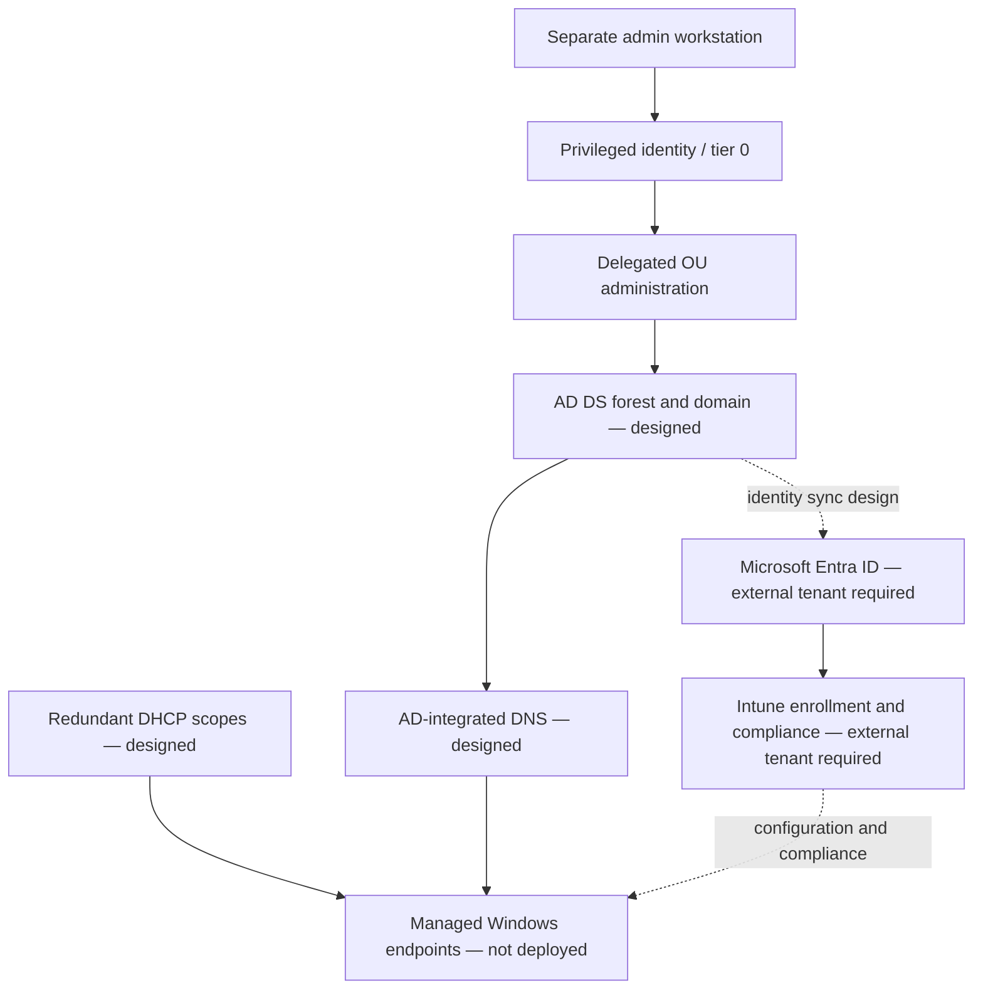

# DOMAINCORE reference architecture

## Proposed directory structure

Use role and resource OUs rather than mirroring every department. A starting design is `OU=Workstations`, `OU=Servers`, `OU=Users`, `OU=Groups`, and `OU=ServiceAccounts`, with a separate admin tier and delegated groups. Keep privileged accounts separate from daily-use identities. Protect OUs against accidental deletion. Validate naming, domain recovery, replication, DNS, time synchronization, and service-account ownership before a real forest is created.

Groups should represent roles or resource access, with AGDLP-style nesting where useful. Delegate specific OU tasks to groups and review ACLs; do not delegate Domain Admin. Disable accounts during offboarding, preserve the object for an approved retention process, revoke sessions/tokens in the actual identity platform, and separately remove entitlements after review.

## DNS and DHCP design

AD clients use only domain DNS servers. Forwarders and conditional forwarders are explicit and monitored. DHCP scope design reserves infrastructure addresses, documents exclusions and lease duration, and uses authorized failover where multiple servers actually exist. DHCP authorization and relay configuration are external deployment steps; no service is configured by this repository.

## Entra ID and Intune boundary

`docs/entra-intune-architecture.md` describes possible identity synchronization and cloud endpoint management. It is a design artifact only. No tenant, directory synchronization, device enrollment, compliance policy, Conditional Access policy or RBAC assignment is present or claimed.
