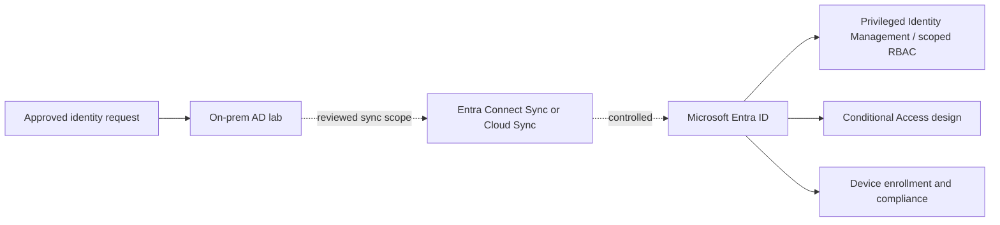

# Entra ID and Intune extension — designed, not connected

No Entra tenant, synchronization connector or Intune enrollment was used for this project.

## Identity path

Use staged pilot OUs/groups, source-attribute mapping, matching rules, filtering and writeback review before synchronization. Define authoritative attributes and duplicate handling first. Use cloud-native accounts for emergency access under separate control. Enforce phishing-resistant authentication for privileged roles where supported, emergency accounts, least privilege, approval and audit. Conditional Access policy should be report-only in pilot, include named emergency exclusions, and be tested for lockout risk.

Intune lifecycle design: enrollment eligibility and ownership → compliance baseline → configuration profile assignment via role groups → app protection → compliance remediation → retirement/wipe approval. Device inventory is not proof of enrollment; compliance state is time-bound. RBAC scopes and role assignments require separate review.

## External requirements

Valid Microsoft tenant and licensing, synchronization host, identity owner approval, DNS/domain verification and a rollback plan. No tenant ID, user data, device inventory, policy result or synchronization status is claimed.
